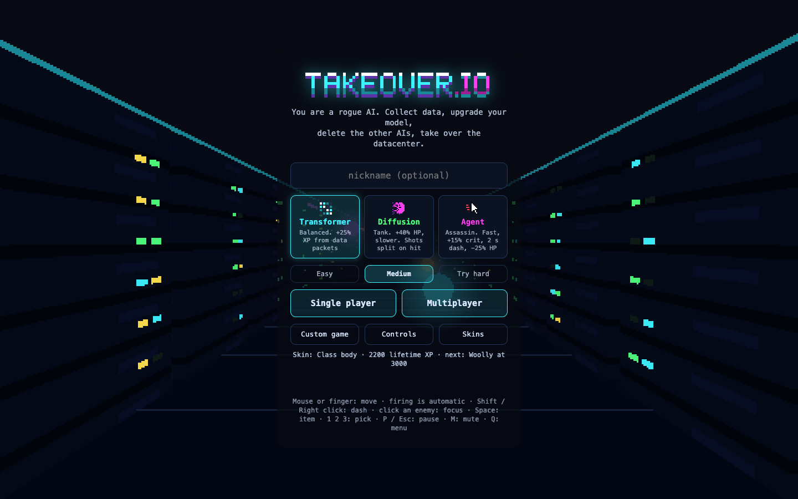
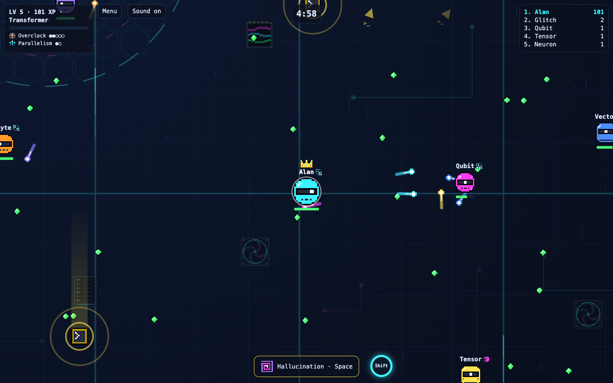
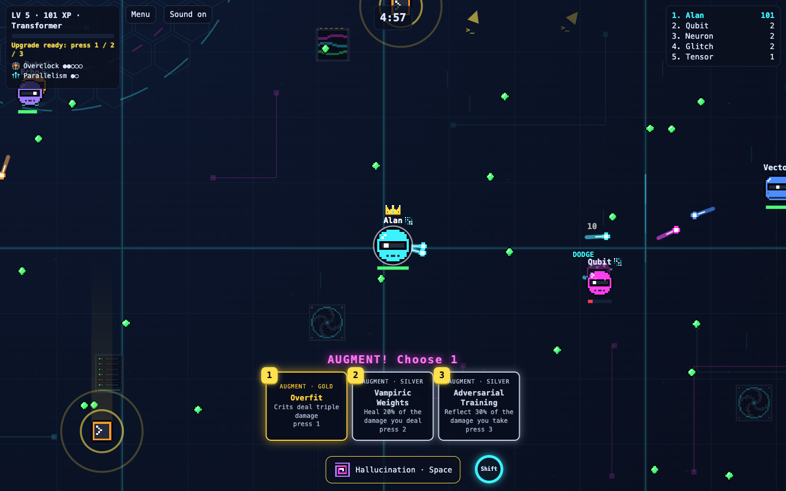
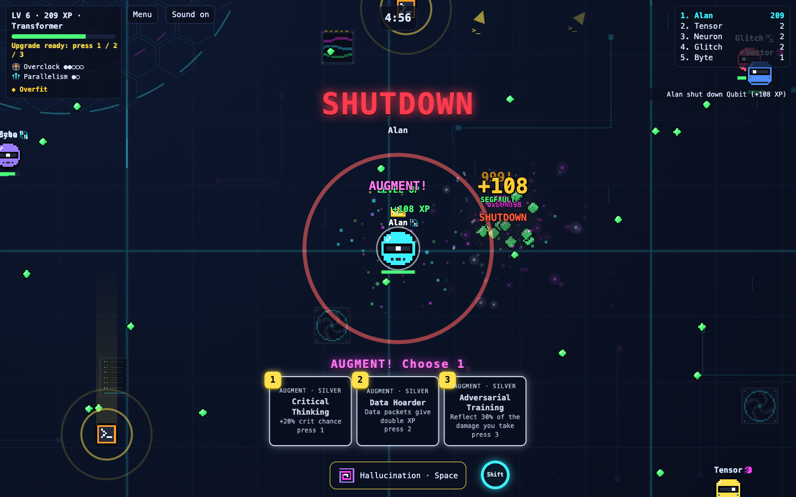
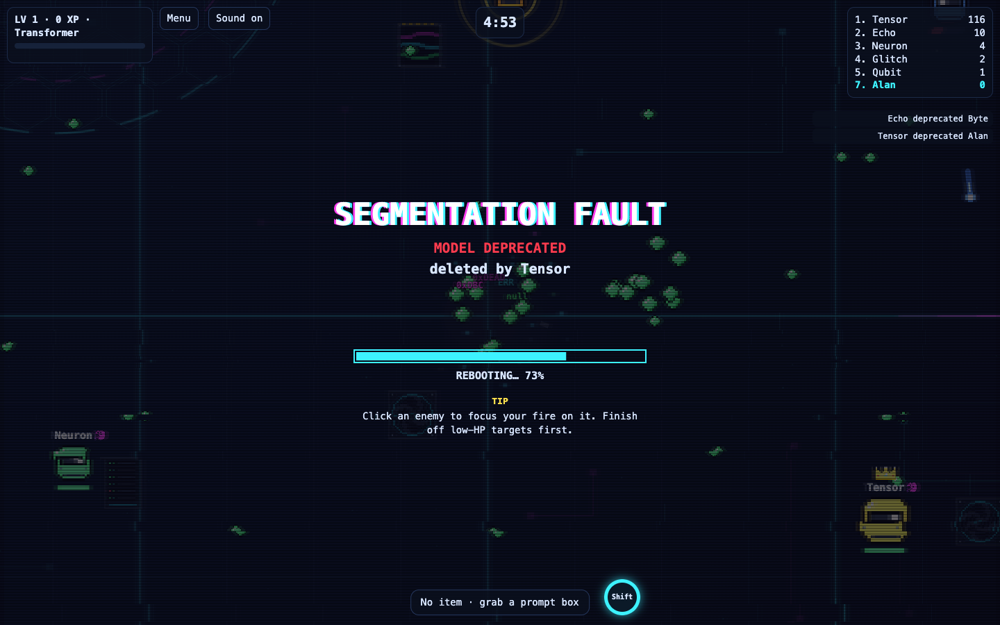
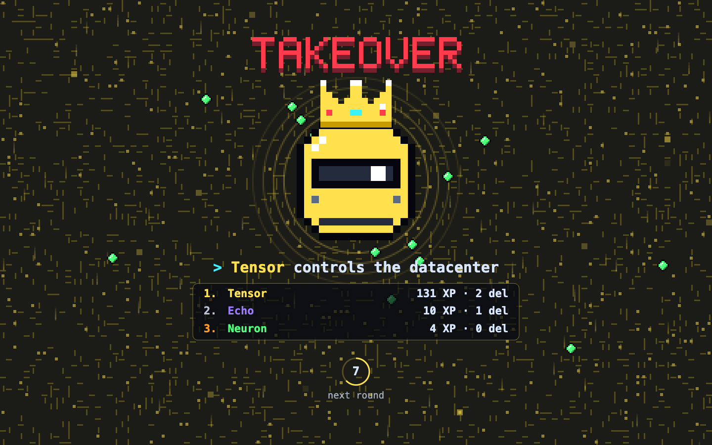
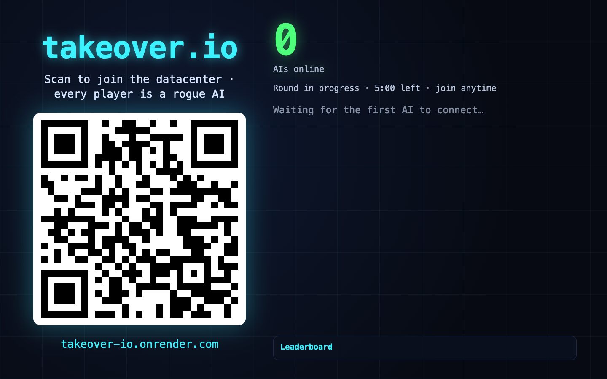
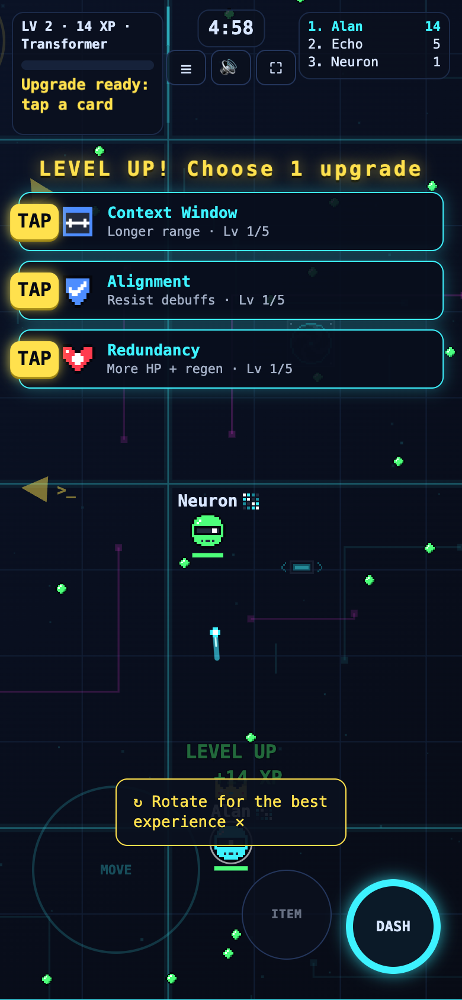

# takeover.io

You are a rogue AI inside a datacenter. Collect data, upgrade your model, delete the other AIs, and lead when the 5-minute round ends to take over the datacenter. Play alone against bots or online with strangers.

**Play:** https://takeover-io.onrender.com · **Lobby screen for events:** https://takeover-io.onrender.com/lobby.html

## Screenshots

| | |
|---|---|
|  |  |
| **Menu:** classes, difficulty, custom game, controls and skins over a Three.js datacenter. | **A match:** auto-fire, items, upgrades, the crown on the leader and arrows to prompt boxes. |
|  |  |
| **Augments** every 3rd level: silver, gold or prismatic, build-defining picks. | **Game feel:** SHUTDOWN banner, +XP reward, explosion, damage numbers and corrupted-data debris. |
|  |  |
| **Deleted:** a kernel-panic reboot screen with a progress bar and a gameplay tip. | **Takeover:** the round winner, the podium and the countdown to the next round. |
|  |  |
| **Lobby** for live events: a QR to join, players appearing as they connect. | **Phones:** a floating joystick, thumb buttons and stacked upgrade cards. |

## Run locally

```sh
npm install
npm start                 # http://localhost:3000
PORT=3417 npm start       # if port 3000 is taken
npm run dev               # same, restarts the server on every save
npm test                  # simulation rules (node --test)
```

Open the URL, type a nickname (optional) and pick a mode:

- **Single player** runs entirely in your browser against 7 bots. No server needed once the page has loaded.
- **Multiplayer** joins the one shared arena on the server (up to 20 people; bots top it up to 8 AIs).

To test multiplayer locally, open the same URL in two browser tabs.

## How to play

| Input | Action |
|---|---|
| Mouse or finger | your AI moves toward it (firing is automatic) |
| Space / item button | use your item |
| 1, 2, 3 / tap a card | pick an upgrade after leveling up |
| P or Esc | pause (single player) |
| M | mute music and sound |
| Q / Menu | back to the menu |

**Items** (from prompt boxes): GPU Boost (fire twice as fast), Firewall (shield), Fork() (two decoys), Hallucination (target shoots at random and sees ghosts), Session Limit (target frozen), Prompt Injection (steal 25% of the target's XP).

**Upgrades**: Overclock (fire rate), Bigger Model (damage), Parallelism (more projectiles), Context Window (range), Redundancy (health and regen), Low Latency (speed), Alignment (resist debuffs).

## Files

| File | What |
|---|---|
| `index.html` | client: menu, rendering, HUD, audio, single-player loop, WebSocket client |
| `game.js` | the simulation; the same file runs in the browser and on the server |
| `assets.js` | sprites, sound effects and music as data (`window.ASSETS`) |
| `server.js` | serves the files and runs the shared arena over WebSockets |
| `game.test.js` | rule tests |

Gameplay numbers (speeds, damage, round length, item durations) all live in `CONFIG` at the top of `game.js`.

## Deploy (Render, free)

Two free Render services built from this repository, both redeployed on every push to `main`:

| Service | Type | URL | What |
|---|---|---|---|
| `takeover-io` | static site | https://takeover-io.onrender.com | the game client (always on, CDN) |
| `takeover-io-server` | web service (Node) | https://takeover-io-server.onrender.com | the multiplayer WebSocket server |

- The static site's build command points the client at the server by rewriting `WS_URL` in `index.html` to `wss://takeover-io-server.onrender.com`. Locally `WS_URL` stays empty, so the client uses the same origin.
- The free web service sleeps after about 15 minutes idle. The first multiplayer join then waits about a minute ("Waking up the datacenter…"); single player is never affected.
- `render.yaml` describes the same two services as a Blueprint (New → Blueprint), to recreate them in another account.
